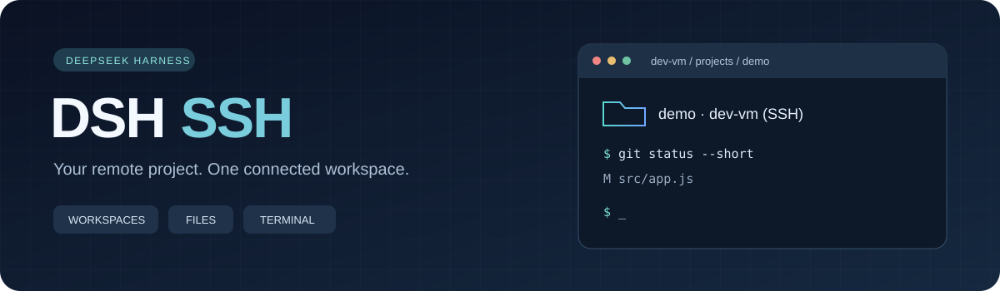
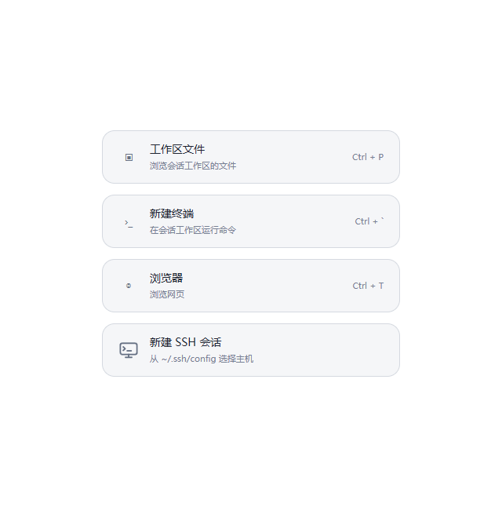
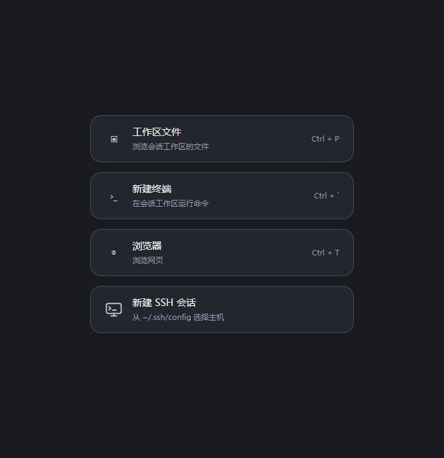
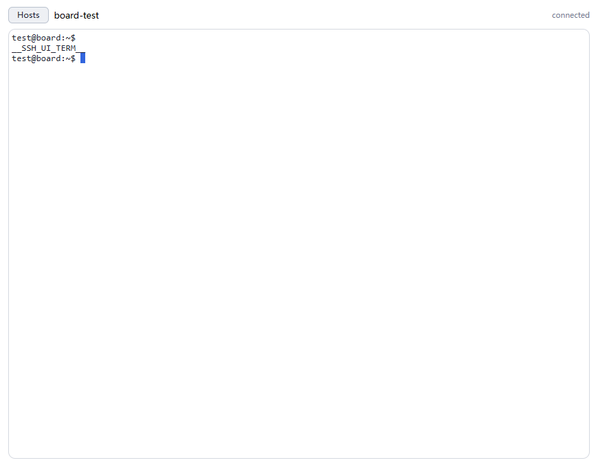

<p align="center">
  
</p>

<p align="center"><strong>在 DeepSeek Harness 中，通过图形界面连接虚拟机与远端工程。</strong></p>

<p align="center">
  
  
  
  
</p>

<p align="center"><a href="#功能">功能</a> · <a href="#安装">安装</a> · <a href="#使用">使用</a> · <a href="#测试">测试</a> · <a href="#当前边界">当前边界</a></p>

---

DSH SSH 是 DeepSeek Harness 的 SSH 插件。它把主机连接、文件浏览、交互终端和 SSH Agent 工具接入同一个工作流，也支持将虚拟机工程添加到左侧工作区。

选择主机与工程目录后，新对话自动继承远端目标。消息框保持空白，直接写任务需求即可。

## 功能

| 功能 | 你可以做什么 |
| :--- | :--- |
| **虚拟机工作区** | 从左侧“添加工作区”选择 SSH 主机与远端目录，为工程创建独立分组。 |
| **图形目录选择器** | 点击目录、返回上级，或输入路径后打开；重复添加同一目录会复用工作区。 |
| **远端文件浏览** | 查看目录、文件类型与大小，预览文本，从目录或指定文件新建对话。 |
| **交互式终端** | 使用真实 `ssh -tt` 会话，支持中文、ANSI 输出与尺寸调整。 |
| **SSH Agent 工具** | 执行命令，搜索、读写和编辑文件，上传、下载二进制文件。 |
| **隔离与恢复** | 每个对话独立绑定主机与路径，界面选择可在重载后恢复。 |

### 界面预览

<p align="center">
  
  
</p>

<p align="center"><sub>亮色与暗色入口预览，使用 DSH 原生卡片样式。截图来自浏览器测试外壳。</sub></p>

<details>
<summary><strong>查看终端演示</strong></summary>



这是加载真实插件与 xterm 的模拟接口演示，不代表真实远端主机连接验收。

</details>

## 安装

### 1. 准备 SSH 连接

本机需要 OpenSSH。先在普通终端确认可以访问目标主机：

```bash
ssh dev-vm
```

在 `~/.ssh/config` 中配置主机别名，例如：

```sshconfig
Host dev-vm
    HostName vm.example.com
    User developer
    IdentityFile ~/.ssh/id_ed25519
```

Agent 工具、目录选择器和非交互命令使用 `BatchMode=yes`，需要密钥或 `ssh-agent` 认证。密码输入仅适用于交互终端。

### 2. 离线安装（GitHub 连接超时时推荐）

下载 [dsh-ssh-0.2.1.tgz](releases/dsh-ssh-0.2.1.tgz?raw=true)，也可由已经下载的人直接发送给你。

1. 把 `.tgz` 文件保存到本机，**不要解压**。
2. 打开 DSH **插件 → 手动安装**。
3. 输入该文件的完整绝对路径，例如 `C:/Downloads/dsh-ssh-0.2.1.tgz`。
4. 安装并启用后，刷新页面或重启 DSH。

这是预构建、无运行时依赖的安装包，安装它不需要 DSH 再连接 GitHub，也不需要 Git。
包名 `@local/dsh-ssh` **尚未发布到 npm**，不能只把这个包名填进安装框。修改 npm 源不能修复 GitHub 仓库连接超时。

可使用对应的 [SHA-256 校验文件](releases/dsh-ssh-0.2.1.tgz.sha256) 核对下载内容：

```powershell
Get-FileHash C:/Downloads/dsh-ssh-0.2.1.tgz -Algorithm SHA256
```

### 3. 从 GitHub 安装（需要网络可达）

DSH 手动安装框可填写：

```text
https://github.com/Sharanie0612/dsh-ssh
```

如果 DSH 的 GitHub 连接预检查超时，改用上面的本地 `.tgz` 方式。

### 4. 源码目录安装

```bash
git clone https://github.com/Sharanie0612/dsh-ssh.git
cd dsh-ssh
```

仓库包含已构建的终端模块，使用插件无需额外安装 xterm 或 React。

打开插件管理界面，将克隆目录的**绝对路径**作为 bundle 安装。也可使用 DSH 的 `plugin_manager` 工具：

```text
plugin_manager {
  action: "install_bundle",
  target: "C:/Projects/dsh-ssh"
}
```

把示例路径换成实际目录。安装后刷新页面或重启 DSH。

> 已验证的桌面版本为 **DSH 0.2.0-rc.2**。其他版本需要重新验证服务与插槽接口的兼容性。

## 使用

### 添加虚拟机工作区

1. 点击左侧 **工作区** 旁的添加按钮。
2. 选择 **SSH 虚拟机**，再选择主机。
3. 点击目录进入工程，或输入路径后点 **打开**。
4. 可选填名称，点击 **添加此目录**。
5. 从新工作区新建对话，直接填写任务。

默认名称为 `工程目录 · 主机名 (SSH)`。对话标题栏显示当前 SSH 目标；选择器也保留 **本机** 文件夹选项。

### 浏览文件与打开终端

打开右侧栏，在“开始”页选择 **新建 SSH 会话**：

- **测试**：检查主机连通性。
- **执行**：运行命令，查看输出与退出码。
- **文件**：浏览远端工程、预览文本，针对目录或文件新建对话。
- **终端**：打开交互 SSH；返回主机页时关闭该终端。

已绑定工作区的对话会恢复主机，文件浏览从对应远端目录开始。

### Agent 工具

| 工具 | 用途 |
| :--- | :--- |
| `ssh_hosts` | 查看主机配置与当前会话目标。 |
| `ssh_connect` / `ssh_disconnect` | 设置或解除当前对话的 SSH 默认目标。 |
| `ssh_exec` | 执行远端命令。 |
| `ssh_ls` / `ssh_read` | 列出目录、读取文本。 |
| `ssh_write` / `ssh_edit` | 写入或编辑文件。 |
| `ssh_glob` / `ssh_grep` | 查找文件、搜索内容。 |
| `ssh_upload` / `ssh_download` | 传输文件并校验 SHA-256。 |

绑定工作区后可省略 `host`，相对路径以所选远端目录为基准。手动连接示例：

```text
ssh_connect { host: "dev-vm", cwd: "~/projects/demo", probe: true }
ssh_exec    { command: "git status --short" }
ssh_read    { path: "README.md" }
```

## 当前边界

- **工作区分组已接入原生 DSH，远端文件仍使用 SSH 文件浏览器。** 原生“工作区文件”和普通本机工具不会自动转为远端访问。
- 当前 DSH 要求工作区对应本机目录。插件在 `.ssh-workspaces/` 下创建空目录承载会话身份，工程内容保留在远端，不进行本地同步。
- 文件浏览界面支持读取与预览；写入、传输和重命名使用 Agent 工具。
- 二进制传输上限 **32 MiB / 次**，文本编辑上限 **2 MiB**；不支持断点续传或目录同步。
- 终端最多保留 **8 个会话**，每个会话保留 **512 KiB** 输出；主机进程重启后需要重新连接。
- 主机列表支持 `Include` 与默认配置，不列出通配别名，也不解析条件 `Match`。实际连接遵循 OpenSSH 配置。
- `ssh_glob` 依赖远端 Bash；`ssh_grep` 优先使用 ripgrep，缺失时回退到 grep。

## 测试

使用 Node.js 24；Windows 后端用例还需要 Git Bash。

```bash
npm test
npm run build
```

| 开发环境验证 | 结果 |
| :--- | :--- |
| 单元与回归测试 | **51 通过**，1 项因 Windows 软链接权限跳过。 |
| 浏览器界面回归 | **8 项通过**，浏览器错误为 0。 |
| 真实 SSH 后端 / 原生 PTY | **5 / 9 项通过**。 |
| 目录与文件对话 | **5 项通过**。 |
| 虚拟机工作区 | **6 项通过**，包含重复添加、自动绑定与重载隔离。 |

浏览器测试使用侧栏与导航外壳，后端使用真实 DSH 服务与 SSH；**尚未完成完整 Electron 鼠标验收**。

复现方法见 [测试指南](docs/testing.md)，范围与记录见 [TEST-REPORT.md](TEST-REPORT.md)。

## 项目结构

```text
lib/        工具、API、工作区绑定、前端与终端模块
src/        终端视图源片段
vendor/     xterm 与 addon-fit，保留第三方许可证
tests/      单元、浏览器与真实 SSH 集成测试
tools/      构建、运行时提取与预览脚本
docs/       使用素材与测试指南
```

修改终端视图或 vendored 资源后，运行 `npm run build`。修改主机代码后重新加载插件或重启 DSH，修改前端后刷新页面。开发用 HMR 监听路径应在本机 profile 配置，bundle 不包含固定机器路径。

生成离线安装包：`npm run pack:offline`。输出在 `releases/`，包中已包含终端模块、bundle 补丁和所需页面资源。

## 认证与许可

插件使用系统 OpenSSH，沿用 `IdentityFile`、`ssh-agent`、`ProxyJump` 和 `known_hosts`。它不保存密码或私钥，也不改写 SSH 配置；界面 API 使用 DSH 原有认证通道。

本项目暂未指定整体开源许可证。`vendor/` 中的 xterm 与 addon-fit 使用 MIT 许可证，原始许可文件已保留。
